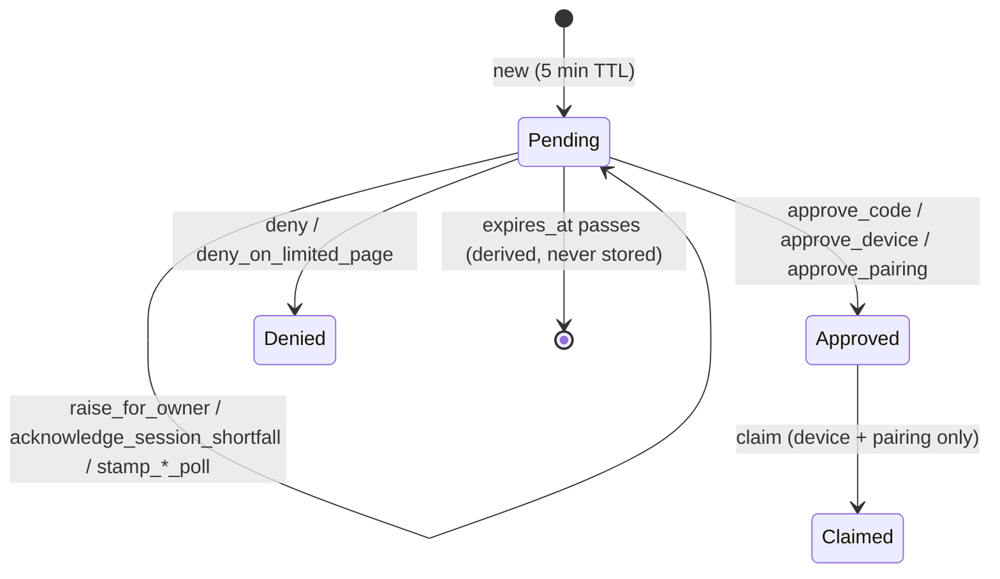

# The Authorization Server, Read in Order

This is a guided read of `authorization-server-rust`. Read it top to bottom. Each chapter tells part of the domain story, and it shows the code at the point where the story depends on it. Every snippet links to its source, so you can jump from the story to the line and back.

## Chapter 1: The Map

### What this server is for

One person, the **Owner**, runs a FHIR server on their own devices. Apps, browsers and devices ask for access to it. This server decides who gets in, with what, and for how long. It never decides alone: every access traces back to a moment when the Owner said yes, either just now or earlier, in a way that still stands.

Everything else in the crate serves that sentence.

### The cast

| Who                 | What they are                                                                                                                                                   | Where they live in code                                     |
| ------------------- | --------------------------------------------------------------------------------------------------------------------------------------------------------------- | ----------------------------------------------------------- |
| The **Owner**       | The person whose data this is. Signs in on their own device with a same-device sign-in code, and decides every request.                                        | `domain::capabilities::oauth::same_device_sign_in`          |
| A **client**        | An app (a SMART-on-FHIR app, a Pebble companion, the host app). It has a `client_id`, maybe a secret, and a registration that is server-defined or trusted on first use. | `domain::client`, `domain::client_registration`             |
| A **browser session** | A browser the server has let in, keyed by its `sid`. Everything minted while using that browser records the `sid`, so revoking the browser revokes what it earned. | `domain::browser_session`                                   |
| A **device**        | Something without a good browser (a TV, a watch) that shows a code for the Owner to type in elsewhere.                                                          | `domain::capabilities::oauth::device_authorizer`            |

### Three ways to ask

Every request for access becomes one row: an **`AuthorizationRequest`**. It comes in three kinds, and they share one lifecycle.

| Kind                   | Who asks                              | What a yes produces                     | Standard          |
| ---------------------- | ------------------------------------- | --------------------------------------- | ----------------- |
| **Authorization code** | An app, running in a paired browser   | A one-minute code, then tokens          | RFC 6749 §4.1 + PKCE |
| **Device code**        | A device showing a user code          | Tokens, collected by the device's poll  | RFC 8628          |
| **Browser pairing**    | A browser wanting to become a session | A browser session, collected by its poll | Ours, not OAuth   |

The order matters. A browser **pairs first** and then makes app requests, because an app's code is always issued under the browser session it was requested in.

### What a yes leaves behind

| Thing              | Lifetime                       | Why it exists                                                                                      |
| ------------------ | ------------------------------ | -------------------------------------------------------------------------------------------------- |
| **Grant**          | Until revoked                  | "The Owner already said yes to this app at this redirect." Lets the next request skip asking.       |
| **Authorization code** | 60 seconds, single use     | Carries the approval from the browser to the app's back end without putting a token in a URL.      |
| **Refresh family** | Rolling                        | One chain of refresh tokens from one redemption. Replaying an old link kills the whole chain.      |
| **Browser session** | Until revoked or expired      | The browser's standing permission. It caps what any app requested in that browser can receive.    |

### How the code is layered

A request moves through the layers from the top down, and the rest of this book follows the same path.

```text
http/routes/…           axum handlers: parse, call ONE capability, render
  └─ domain/capabilities/…   one operation = one store scope (read or write)
       ├─ domain/<entity>.rs      the rules: AuthorizationRequest, BrowserSession, …
       ├─ domain/authority/…      proofs: "on whose authority is this written?"
       └─ domain/capabilities/writers/…  the ONLY place privileged writes happen
            └─ domain/grant_store/…      the port: GrantStore opens a scope, GrantTx does one statement
                 └─ db/…                 the SQL behind each GrantTx method
```

Hold on to three rules while you read. Most of the code exists to enforce one of them.

1. **One operation, one scope.** A capability opens a single read or write scope at its top, runs the whole flow inside it, and does side effects (notifying the Owner, signing a token) only after the scope closes.
2. **Every privileged write takes a proof.** You can't call "issue a code" without passing a value that only the rule-checking function can construct. Auditing who can grant access means reading two short lists: the proofs in `domain/authority/` and the writers in `capabilities/writers/`.
3. **A request changes only through its own transitions**, and a transition lands only if the row hasn't moved since it was read. Chapter 2 is about this rule.

## Chapter 2: The Life of an App's Request

We'll follow one request from start to finish.

> The Owner has paired their laptop browser. They open **Wildflower Strength**, a SMART app, in that browser. Strength asks for `patient/Observation.rs` and `launch/patient`.

### 2.1 The front door: no session, no request

The browser lands on `GET /oauth/authorize`. The first check isn't about the app at all. It's about the browser: does it carry a browser session?

[`http/routes/oauth/authorize.rs` L256–269](https://github.com/wildflowerhealthio/Wildflower/blob/284f2a000729b19e5884dece4e34534745799f6b/apps/host/wildflower-server/authorization-server-rust/src/http/routes/oauth/authorize.rs#L256-L269)

```rust
    // No browser session, no authorization: pair this browser first, then
    // come back to this very request. Nothing is parked, notified or consumed.
    let Some((browser_session, browser_sid)) = browser_session
        .as_ref()
        .and_then(|claims| Some((claims, claims.sid.as_deref()?)))
    else {
        return Ok(found_redirect(&pairing_page_location(
            authorize_uri
                .path_and_query()
                .map_or(authorize_uri.path(), |path_and_query| {
                    path_and_query.as_str()
                }),
        )));
    };
```

**Domain reason:** a code is always issued *under* a browser session (its `sid`). Without a session there's nothing to issue under and nothing to revoke later, so the browser is sent to pair first. It comes back to this exact URL afterwards. Nothing is written yet, so a SMART `launch` value isn't spent by the detour.

Everything after this point happens in one write scope, in `CodeAuthorizationStarter::start`.

### 2.2 Three questions decide where the browser goes

After validation (redirect URI, PKCE, a registration check that trusts unknown clients on first use), the starter asks three questions about the request. Their answers pick the next step:

[`code_authorization_starter.rs` L101–121](https://github.com/wildflowerhealthio/Wildflower/blob/284f2a000729b19e5884dece4e34534745799f6b/apps/host/wildflower-server/authorization-server-rust/src/domain/capabilities/oauth/code_authorization_starter.rs#L101-L121)

```rust
pub(crate) enum AuthorizeNextStep {
    RedirectToClient { redirect_uri: Url, code: String, client_state: String },
    AwaitOwner { request_id: String, decidable_in_requesting_browser: bool },
    ConfirmSessionShortfall { request_id: String },
}
```

*(doc comments elided)*

| Question                                                                 | Domain meaning                                                                                                                 | If yes →                       |
| ------------------------------------------------------------------------ | ------------------------------------------------------------------------------------------------------------------------------ | ------------------------------ |
| **Does this browser's session hold less than the app asks for?**         | The laptop was paired with read-only access but the app wants write. The browser itself should know this before anyone else is bothered. | The **limited page** (§2.4)    |
| **Does a standing grant already cover everything asked for?**            | The Owner said yes to this app at this redirect before and hasn't revoked it.                                                  | Issue a code now (§2.7)        |
| **Can this browser decide the request itself?**                          | The person at the browser *is* the Owner, with enough authority to approve this request.                                       | The **consent card**, in place |
| *(otherwise)*                                                            | Someone else is using this browser.                                                                                            | The **wait page**, and the Owner is notified on their device |

Two of these answers are computed side by side, right before the request is parked:

[`code_authorization_starter.rs` L332–349](https://github.com/wildflowerhealthio/Wildflower/blob/284f2a000729b19e5884dece4e34534745799f6b/apps/host/wildflower-server/authorization-server-rust/src/domain/capabilities/oauth/code_authorization_starter.rs#L332-L349)

```rust
        let decidable_in_requesting_browser = authorize_query.can_decide_consents
            && resolved
                .approvable_scopes()
                .missing_approval_scopes(authorize_query.browser_session_grant)
                .is_empty();
        let coverage = GrantCoverage::resolve(
            tx,
            resolved.registration_verdict(),
            authorize_query.client_id,
            &requested_redirect_uri,
            &requested_scopes,
        )?;
        let waits_on_limited_page =
            !session_shortfall(&requested_scopes, authorize_query.browser_session_grant).is_empty()
                && !tx.session_shortfall_acknowledged_for_client(
                    authorize_query.sid,
                    authorize_query.client_id,
                )?;
```

Note the second half of `waits_on_limited_page`. The limited page is shown **once per browser per app**. Once this browser has pressed Continue for Strength, later Strength requests skip the page, whatever the session lacks.

### 2.3 Parking: the request becomes a row

Every path except "refused outright" parks an `AuthorizationRequest`. This is the entity, and the rest of its life is its status:

[`authorization_request.rs` L63–73](https://github.com/wildflowerhealthio/Wildflower/blob/284f2a000729b19e5884dece4e34534745799f6b/apps/host/wildflower-server/authorization-server-rust/src/domain/authorization_request.rs#L63-L73)

```rust
pub enum RequestStatus {
    /// Awaiting the Owner's decision (until it expires).
    Pending,
    /// The Owner approved it: it carries its [`Approval`].
    Approved,
    /// The Owner, or the browser that made it, declined it.
    Denied,
    /// An approved device request or browser pairing whose poll redeemed the
    /// approval, once (RFC 8628 §3.4 single use). It keeps its [`Approval`].
    Claimed,
}
```



There's no `Expired` status. Expiry is a fact about time, so it's computed from `expires_at` whenever someone asks (`pending_at(now)`) and never written. A code request stays `Approved` forever. Its single-use guarantee lives on the **code** (§2.8), not on the request.

The code-flow request carries a few domain facts beyond the shared core. These are the ones the rest of the story uses ([`CodeRequest`, L96–129](https://github.com/wildflowerhealthio/Wildflower/blob/284f2a000729b19e5884dece4e34534745799f6b/apps/host/wildflower-server/authorization-server-rust/src/domain/authorization_request.rs#L96-L129)):

| Field                              | The fact it records                                                                                     |
| ---------------------------------- | ------------------------------------------------------------------------------------------------------- |
| `sid`                              | The browser the request was made in. The code will be issued under **this** session, not the approver's. |
| `launch_bound_patient`             | The patient a SMART launch pinned. An approval naming a different patient is refused.                    |
| `decidable_in_requesting_browser`  | Answer to question 3. Raising the request for the Owner sets it to `false`.                              |
| `session_shortfall_acknowledged`   | `false` while the request waits on the limited page. **The Owner isn't shown a request until this is `true`.** |
| `pre_approved_scopes`              | What a standing grant already covered. The consent card shows them pre-ticked.                           |

### 2.4 The limited page and the race it creates

Suppose the laptop's session lacks `patient/Observation.rs`. Strength's request parks with `session_shortfall_acknowledged: false`, and the browser goes to `/oauth/authorize/{id}/limited`. The page says what's missing and offers **Continue** or **Cancel**.

Both buttons are transitions on the entity:

[`authorization_request.rs` L560–592](https://github.com/wildflowerhealthio/Wildflower/blob/284f2a000729b19e5884dece4e34534745799f6b/apps/host/wildflower-server/authorization-server-rust/src/domain/authorization_request.rs#L560-L592)

```rust
    pub fn acknowledge_session_shortfall(
        &self,
        ttl: Duration,
        now: DateTime<Utc>,
    ) -> Result<RequestTransition, TransitionRefused> {
        let code_request = self.waiting_on_limited_page(now)?;
        Ok(self.transition(AuthorizationRequest {
            expires_at: now + ttl,
            kind: RequestKind::AuthorizationCode(CodeRequest {
                session_shortfall_acknowledged: true,
                ..code_request.clone()
            }),
            ..self.clone()
        }))
    }

    pub fn deny_on_limited_page(
        &self,
        now: DateTime<Utc>,
    ) -> Result<RequestTransition, TransitionRefused> {
        self.waiting_on_limited_page(now)?;
        Ok(self.transition(AuthorizationRequest {
            status: RequestStatus::Denied,
            ..self.clone()
        }))
    }
```

**The race:** Continue leaves the status `Pending` and flips `session_shortfall_acknowledged`. Cancel flips the status and leaves the flag alone. If two tabs press them at the same moment, a guard that only checked `status` would let both land. The request would end up denied *and* acknowledged, and the Owner would be asked to approve a request that is already refused.

That's why every transition records both fields as the **phase** it was read in:

[`authorization_request.rs` L216–219](https://github.com/wildflowerhealthio/Wildflower/blob/284f2a000729b19e5884dece4e34534745799f6b/apps/host/wildflower-server/authorization-server-rust/src/domain/authorization_request.rs#L216-L219), [L691–696](https://github.com/wildflowerhealthio/Wildflower/blob/284f2a000729b19e5884dece4e34534745799f6b/apps/host/wildflower-server/authorization-server-rust/src/domain/authorization_request.rs#L691-L696)

```rust
pub struct RequestPhase {
    pub status: RequestStatus,
    pub session_shortfall_acknowledged: bool,
}

    fn transition(&self, changed: AuthorizationRequest) -> RequestTransition {
        RequestTransition {
            read_in: self.phase(),
            request: changed,
        }
    }
```

### 2.5 The guarded replace: first decision wins

A transition is only a value: the changed request plus the phase it was read in. It does nothing until the store writes it, and the store writes it with one `UPDATE` that matches the old phase:

[`db/authorization_requests.rs` L342–358](https://github.com/wildflowerhealthio/Wildflower/blob/284f2a000729b19e5884dece4e34534745799f6b/apps/host/wildflower-server/authorization-server-rust/src/db/authorization_requests.rs#L342-L358)

```rust
        let read_in = transition.read_in();
        let row = Row::from(transition.request());
        let affected = diesel::update(
            authorization_requests::table
                .find(&row.id)
                .filter(authorization_requests::status.eq(read_in.status))
                .filter(
                    authorization_requests::session_shortfall_acknowledged
                        .eq(read_in.session_shortfall_acknowledged),
                ),
        )
        .set(&row)
        .execute(self.conn)
        // …
        Ok(affected == 1)
```

`affected == 1` means "you won". `0` means someone else moved the row first, and every caller treats that as "this request is no longer there for you" (a not-found). The same mechanism covers:

- two surfaces deciding the same request at once (the host popup and a signed-in launcher's consent list),
- Continue racing Cancel (§2.4),
- a device poll stamp racing an approval. A stamp doesn't change the phase, so an approval read before the stamp still lands.

The shared helper that turns "the entity refused" and "the row moved" into the same `false` is [`write_transition`](https://github.com/wildflowerhealthio/Wildflower/blob/284f2a000729b19e5884dece4e34534745799f6b/apps/host/wildflower-server/authorization-server-rust/src/domain/grant_store/authorization_requests.rs#L119-L127).

### 2.6 The Owner decides

Strength's request is now pending and acknowledged. The laptop browser can't decide it (the laptop isn't the Owner), so it went to the wait page, and the host app on the Owner's phone showed a popup. The Owner ticks scopes and taps Approve. That arrives at `ConsentDecider::approve_oauth_consent`.

Before anything is written, the Owner's ticks become a **proof**:

[`consents/oauth.rs` L195–199](https://github.com/wildflowerhealthio/Wildflower/blob/284f2a000729b19e5884dece4e34534745799f6b/apps/host/wildflower-server/authorization-server-rust/src/domain/capabilities/access/consents/oauth.rs#L195-L199)

```rust
        let maybe_delegated_scopes = DelegatedScopes::clamp(
            &self.approver_grant,
            input.owner_approved_scopes,
            resolved.approvable_scopes(),
        )?;
```

**Domain rule:** you can't give away what you don't hold. `DelegatedScopes` is what's left after clamping the ticked scopes to what the app may ask for (requested ∩ registration). Then the approver's own grant must cover every survivor, or the whole approval fails with `403` instead of being quietly reduced. If nothing survives, the request is denied. The approver also can't bind a patient other than the one the SMART launch pinned (`admits_patient`).

### 2.7 Approving and issuing the code

Both paths to a code go through one writer method, `RequestApprover::approve_for_code`: the Owner's approval from §2.6, and the standing-grant fast path from §2.2. It takes a `CodeAuthority`, an enum with exactly two variants: `OwnerDelegated` or `StandingGrant`. **That enum is the complete answer to "what can cause a code to be issued?"**

[`writers/request_approver.rs` L112–146](https://github.com/wildflowerhealthio/Wildflower/blob/284f2a000729b19e5884dece4e34534745799f6b/apps/host/wildflower-server/authorization-server-rust/src/domain/capabilities/writers/request_approver.rs#L112-L146)

```rust
        let Some(browser_session) = self
            .tx
            .browser_session_by_sid(&code_request.sid)?
            .filter(|browser_session| browser_session.is_live(now))
        else {
            return Ok(if write_transition(self.tx, request.deny(now))? {
                CodeApproval::BrowserSessionEnded
            } else {
                CodeApproval::RequestNotPending
            });
        };
        let approval = Approval {
            granted_scopes: authorized_scopes.to_vec(),
            patient: patient.map(str::to_owned),
        };
        if !write_transition(self.tx, request.approve_code(approval, now))? {
            return Ok(CodeApproval::RequestNotPending);
        }
        let authorization_code = IssuedAuthorizationCode {
            // …
            granted_scopes: session_bounded_scopes(
                authorized_scopes,
                &Grant::parse(&browser_session.scopes),
            ),
            // …
            expires_at: now + AUTHORIZATION_CODE_TTL,
            sid: browser_session.sid,
        };
        self.tx.issue_authorization_code(&authorization_code)?;
```

Three domain rules, in the order they run:

1. **The requesting browser must still be live.** If the laptop was signed out while the Owner was deciding, the approval becomes a denial and Strength hears `access_denied`. There's no session left to issue under.
2. **The request records what the Owner approved** (`Approval.granted_scopes`). That's the audit record of the decision.
3. **The code carries less: the approval intersected with the browser's session** (`session_bounded_scopes`). A browser paired read-only earns its apps read-only access, whoever approved. The `sid` goes on the code, so revoking the laptop later ends everything Strength earned there.

On the Owner path, a **grant** is then recorded for (Strength, its redirect). That's what makes the next request's question 2 answer "yes".

**The fast path** ([`decide`, L567–578](https://github.com/wildflowerhealthio/Wildflower/blob/284f2a000729b19e5884dece4e34534745799f6b/apps/host/wildflower-server/authorization-server-rust/src/domain/capabilities/oauth/code_authorization_starter.rs#L567-L578)) is the one place a code is issued with no human in the loop. It runs only when the standing grant covers every requested scope of a *registered* client **and** names a patient the launch admits. Clients trusted on first use never take it.

### 2.8 Redemption: the code is spent once

The browser is sent back to Strength's redirect with `?code=…&state=…`. Strength's back end posts the code and its PKCE verifier to `/oauth/token`. That builds the proof `RedeemedAuthorizationCode`:

[`authority/redemption.rs` L175–185](https://github.com/wildflowerhealthio/Wildflower/blob/284f2a000729b19e5884dece4e34534745799f6b/apps/host/wildflower-server/authorization-server-rust/src/domain/authority/redemption.rs#L175-L185)

```rust
        // A concurrent redemption of the same code can only succeed once, so
        // any racer past this point sees `None` (RFC 6749 §10.5).
        let Some(code) = tx.redeem_authorization_code(presented.code)? else {
            tx.expire_refresh_token_families_for_authorization_code(
                &token_storage_hash(presented.code),
                now,
            )?;
            return Ok(Err(TokenExchangeError::InvalidGrant(
                InvalidGrantReason::CodeNotFoundOrRedeemed,
            )));
        };
```

**Domain rule:** a code presented twice means someone else has seen it. The second presentation fails, and it also **expires every refresh family the first redemption started**. The attacker gets nothing, and the real app has to ask again, which the Owner will notice.

After that come the bindings (same client, same redirect, PKCE verifier matches the challenge, not expired). Then the token is minted with the code's scopes, which are already bounded by the session. No later step can widen them.

### 2.9 Where the story lands

Follow the scopes and each step can only narrow them:

```text
asked for      ∩ registration           → approvable          (2.6)
approvable     ∩ Owner's ticks, ⊆ Owner → DelegatedScopes     (2.6)
DelegatedScopes                         → Approval on request (2.7, the record)
DelegatedScopes ∩ browser session       → code's scopes       (2.7, what's issued)
code's scopes                           → token's scopes      (2.8)
```

When you review a change to this crate, ask which arrow it touches. If it touches none, it shouldn't be able to change what anyone can access. If it touches one, the proof or writer at that arrow is where to look.
