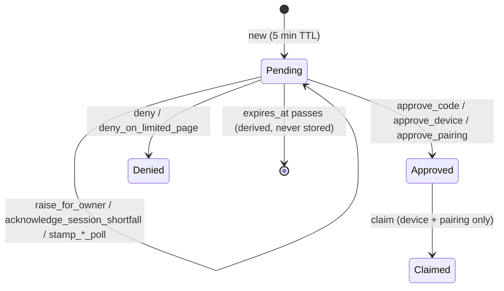

# The Life of an App's Request

We'll follow one request from start to finish.

> The Owner has paired their laptop browser. They open **Wildflower Strength**, a SMART app, in that browser. Strength asks for `patient/Observation.rs` and `launch/patient`.

## The front door: no session, no request

The browser lands on `GET /oauth/authorize`. The first check isn't about the app at all. It's about the browser: does it carry a browser session?

{{#code apps/host/wildflower-server/authorization-server-rust/src/http/routes/oauth/authorize.rs handle_authorize_request from="// No browser session, no authorization" through="let Some((browser_session, browser_sid))"}}

**Domain reason:** a code is always issued _under_ a browser session (its `sid`). Without a session there's nothing to issue under and nothing to revoke later, so the browser is sent to pair first. It comes back to this exact URL afterwards. Nothing is written yet, so a SMART `launch` value isn't spent by the detour.

Everything after this point happens in one write scope, in `CodeAuthorizationStarter::start`.

## Three questions decide where the browser goes

After validation (redirect URI, PKCE, a registration check that trusts unknown clients on first use), the starter asks three questions about the request. Their answers pick the next step:

{{#code apps/host/wildflower-server/authorization-server-rust/src/domain/capabilities/oauth/code_authorization_starter.rs AuthorizeNextStep}}

| Question                                                         | Domain meaning                                                                                                                           | If yes →                                                          |
| ---------------------------------------------------------------- | ---------------------------------------------------------------------------------------------------------------------------------------- | ----------------------------------------------------------------- |
| **Does this browser's session hold less than the app asks for?** | The laptop was paired with read-only access but the app wants write. The browser itself should know this before anyone else is bothered. | The **[limited page](#the-limited-page-and-the-race-it-creates)** |
| **Does a standing grant already cover everything asked for?**    | The Owner said yes to this app at this redirect before and hasn't revoked it.                                                            | [Issue a code now](#approving-and-issuing-the-code)               |
| **Can this browser decide the request itself?**                  | The person at the browser _is_ the Owner, with enough authority to approve this request.                                                 | The **consent card**, in place                                    |
| _(otherwise)_                                                    | Someone else is using this browser.                                                                                                      | The **wait page**, and the Owner is notified on their device      |

Two of these answers are computed side by side, right before the request is parked:

{{#code apps/host/wildflower-server/authorization-server-rust/src/domain/capabilities/oauth/code_authorization_starter.rs CodeAuthorizationStarter::start_in from="let decidable_in_requesting_browser" through="let waits_on_limited_page"}}

Note the second half of `waits_on_limited_page`. The limited page is shown **once per browser per app**. Once this browser has pressed Continue for Strength, later Strength requests skip the page, whatever the session lacks.

## Parking: the request becomes a row

Every path except "refused outright" parks an `AuthorizationRequest`. This is the entity, and the rest of its life is its status:

{{#code apps/host/wildflower-server/authorization-server-rust/src/domain/authorization_request.rs RequestStatus keep-docs}}



There's no `Expired` status. Expiry is a fact about time, so it's computed from `expires_at` whenever someone asks (`pending_at(now)`) and never written. A code request stays `Approved` forever. Its single-use guarantee lives on the **code** ([redemption](#redemption-the-code-is-spent-once)), not on the request.

The code-flow request carries a few domain facts beyond the shared core. These are the ones the rest of the story uses ({{#code-link apps/host/wildflower-server/authorization-server-rust/src/domain/authorization_request.rs CodeRequest}}):

| Field                             | The fact it records                                                                                            |
| --------------------------------- | -------------------------------------------------------------------------------------------------------------- |
| `sid`                             | The browser the request was made in. The code will be issued under **this** session, not the approver's.       |
| `launch_bound_patient`            | The patient a SMART launch pinned. An approval naming a different patient is refused.                          |
| `decidable_in_requesting_browser` | Answer to question 3. Raising the request for the Owner sets it to `false`.                                    |
| `session_shortfall_acknowledged`  | `false` while the request waits on the limited page. **The Owner isn't shown a request until this is `true`.** |
| `pre_approved_scopes`             | What a standing grant already covered. The consent card shows them pre-ticked.                                 |

## The limited page and the race it creates

Suppose the laptop's session lacks `patient/Observation.rs`. Strength's request parks with `session_shortfall_acknowledged: false`, and the browser goes to `/oauth/authorize/{id}/limited`. The page says what's missing and offers **Continue** or **Cancel**.

Both buttons are transitions on the entity:

{{#code apps/host/wildflower-server/authorization-server-rust/src/domain/authorization_request.rs AuthorizationRequest::acknowledge_session_shortfall}}

{{#code apps/host/wildflower-server/authorization-server-rust/src/domain/authorization_request.rs AuthorizationRequest::deny_on_limited_page}}

**The race:** Continue leaves the status `Pending` and flips `session_shortfall_acknowledged`. Cancel flips the status and leaves the flag alone. If two tabs press them at the same moment, a guard that only checked `status` would let both land. The request would end up denied _and_ acknowledged, and the Owner would be asked to approve a request that is already refused.

That's why every transition records both fields as the **phase** it was read in:

{{#code apps/host/wildflower-server/authorization-server-rust/src/domain/authorization_request.rs RequestPhase}}

{{#code apps/host/wildflower-server/authorization-server-rust/src/domain/authorization_request.rs AuthorizationRequest::transition}}

## The guarded replace: first decision wins

A transition is only a value: the changed request plus the phase it was read in. It does nothing until the store writes it, and the store writes it with one `UPDATE` that matches the old phase:

{{#code apps/host/wildflower-server/authorization-server-rust/src/db/authorization_requests.rs SqliteGrantTx::replace_authorization_request from="let read_in" to=".execute(self.conn)" from="Ok(affected == 1)"}}

`affected == 1` means "you won". `0` means someone else moved the row first, and every caller treats that as "this request is no longer there for you" (a not-found). The same mechanism covers:

- two surfaces deciding the same request at once (the host popup and a signed-in launcher's consent list),
- Continue racing Cancel ([the limited page](#the-limited-page-and-the-race-it-creates)),
- a device poll stamp racing an approval. A stamp doesn't change the phase, so an approval read before the stamp still lands.

The shared helper that turns "the entity refused" and "the row moved" into the same `false` is {{#code-link apps/host/wildflower-server/authorization-server-rust/src/domain/grant_store/authorization_requests.rs write_transition}}.

## The Owner decides

Strength's request is now pending and acknowledged. The laptop browser can't decide it (the laptop isn't the Owner), so it went to the wait page, and the host app on the Owner's phone showed a popup. The Owner ticks scopes and taps Approve. That arrives at `ConsentDecider::approve_oauth_consent`.

Before anything is written, the Owner's ticks become a **proof**:

{{#code apps/host/wildflower-server/authorization-server-rust/src/domain/capabilities/access/consents/oauth.rs ConsentDecider::approve_oauth_in from="let maybe_delegated_scopes"}}

**Domain rule:** you can't give away what you don't hold. `DelegatedScopes` is what's left after clamping the ticked scopes to what the app may ask for (requested ∩ registration). Then the approver's own grant must cover every survivor, or the whole approval fails with `403` instead of being quietly reduced. If nothing survives, the request is denied. The approver also can't bind a patient other than the one the SMART launch pinned (`admits_patient`).

## Approving and issuing the code

Both paths to a code go through one writer method, `RequestApprover::approve_for_code`: the Owner's approval ([the Owner decides](#the-owner-decides)), and the standing-grant fast path ([three questions](#three-questions-decide-where-the-browser-goes)). It takes a `CodeAuthority`, an enum with exactly two variants: `OwnerDelegated` or `StandingGrant`. **That enum is the complete answer to "what can cause a code to be issued?"**

{{#code apps/host/wildflower-server/authorization-server-rust/src/domain/capabilities/writers/request_approver.rs RequestApprover::approve_for_code from="let Some(browser_session)" to="let authorization_code" from="granted_scopes: session_bounded_scopes" from="expires_at:" to="self.tx.issue_authorization_code"}}

Three domain rules, in the order they run:

1. **The requesting browser must still be live.** If the laptop was signed out while the Owner was deciding, the approval becomes a denial and Strength hears `access_denied`. There's no session left to issue under.
2. **The request records what the Owner approved** (`Approval.granted_scopes`). That's the audit record of the decision.
3. **The code carries less: the approval intersected with the browser's session** (`session_bounded_scopes`). A browser paired read-only earns its apps read-only access, whoever approved. The `sid` goes on the code, so revoking the laptop later ends everything Strength earned there.

On the Owner path, a **grant** is then recorded for (Strength, its redirect). That's what makes the next request's question 2 answer "yes".

**The fast path** ({{#code-link apps/host/wildflower-server/authorization-server-rust/src/domain/capabilities/oauth/code_authorization_starter.rs decide from="// The fast path:" through="let fast_path_coverage"}}) is the one place a code is issued with no human in the loop. It runs only when the standing grant covers every requested scope of a _registered_ client **and** names a patient the launch admits. Clients trusted on first use never take it.

## Redemption: the code is spent once

The browser is sent back to Strength's redirect with `?code=…&state=…`. Strength's back end posts the code and its PKCE verifier to `/oauth/token`. That builds the proof `RedeemedAuthorizationCode`:

{{#code apps/host/wildflower-server/authorization-server-rust/src/domain/authority/redemption.rs RedeemedAuthorizationCode::redeem from="// A concurrent redemption" through="let Some(code)"}}

**Domain rule:** a code presented twice means someone else has seen it. The second presentation fails, and it also **expires every refresh family the first redemption started**. The attacker gets nothing, and the real app has to ask again, which the Owner will notice.

After that come the bindings (same client, same redirect, PKCE verifier matches the challenge, not expired). Then the token is minted with the code's scopes, which are already bounded by the session. No later step can widen them.

## Where the story lands

Follow the scopes and each step can only narrow them:

```text
asked for      ∩ registration           → approvable          (the Owner decides)
approvable     ∩ Owner's ticks, ⊆ Owner → DelegatedScopes     (the Owner decides)
DelegatedScopes                         → Approval on request (approving: the record)
DelegatedScopes ∩ browser session       → code's scopes       (approving: what's issued)
code's scopes                           → token's scopes      (redemption)
```

When you review a change to this crate, ask which arrow it touches. If it touches none, it shouldn't be able to change what anyone can access. If it touches one, the proof or writer at that arrow is where to look.
