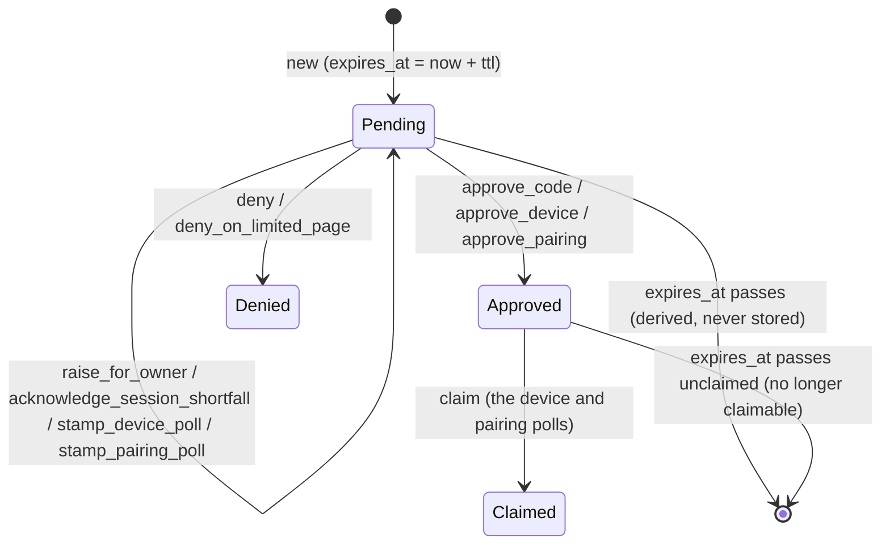

# Authorization Request

{{#covers apps/host/wildflower-server/authorization-server-rust/src/domain/authorization_request.rs}}

Every request for access becomes one `AuthorizationRequest`. An app at `/oauth/authorize` asking for a code, a device asking for a token through the device flow, a browser asking the Owner for a browser session at the pairing page: each parks one request, and the Owner (or a browser allowed to decide for them) answers it. **Three kinds share one lifecycle.** The request starts pending, is approved or denied once, and, for the two kinds that start something on a later poll, is claimed once.

The lifecycle is the entity's own. Its fields are private: a request is started by [`new`](#new), read back by [`restore`](#restore), and changed only by its transitions. A transition doesn't write anything. It answers with the changed request and the phase it was read in, and the store's [guarded replace](#the-guarded-replace-first-decision-wins) writes it only if nobody moved the row first.

{{#code apps/host/wildflower-server/authorization-server-rust/src/domain/authorization_request.rs AuthorizationRequest}}

The common core is who asked (`client_id`), for what (`requested_scopes`), when (`requested_at`), until when (`expires_at`), where it stands (`status`), and what the Owner said yes to (`approval`, present exactly when the request is approved or claimed). The `id` is the device's `device_code`, the pairing code, or for a code request an internal UUID. Everything else belongs to the kind:

{{#code apps/host/wildflower-server/authorization-server-rust/src/domain/authorization_request.rs RequestKind}}

{{#code apps/host/wildflower-server/authorization-server-rust/src/domain/authorization_request.rs Approval}}

An `Approval` is the record of the decision: the scopes granted and the SMART patient bound, if any.

## The code request

The authorization-code kind carries the most domain facts: the browser that made it, the launch that started it and the standing grant it met all shape what happens next.

{{#code apps/host/wildflower-server/authorization-server-rust/src/domain/authorization_request.rs CodeRequest}}

| Field                             | The fact it records                                                                                                                                                                                                |
| --------------------------------- | ------------------------------------------------------------------------------------------------------------------------------------------------------------------------------------------------------------------ |
| `redirect_uri`, `client_state`    | Where the code or error goes back, and the `state` the app gets back with it.                                                                                                                                      |
| `code_challenge`                  | The PKCE S256 challenge the redemption checks.                                                                                                                                                                     |
| `sid`                             | The browser session the request was made in. The code will be issued under **this** session, not the approver's.                                                                                                   |
| `launch`, `launch_bound_patient`  | The SMART `launch` value the request consumed, and the patient it pins. An approval must name exactly that patient ([`admits_patient`](#admits_patient)).                                                          |
| `pre_approved_scopes`             | The requested scopes a standing grant already covered when the request parked. The consent card shows them ticked.                                                                                                 |
| `decidable_in_requesting_browser` | Whether the browser that made the request can decide it itself: its session can decide consents and holds the request's approval scopes. [Raising the request for the Owner](#raise_for_owner) sets it to `false`. |
| `session_shortfall_acknowledged`  | `false` while the request waits on its browser's [limited page](#the-limited-page-and-the-race-it-creates). **The Owner isn't asked about a request until this is `true`.**                                        |

The other two kinds carry what their polls need: the `user_code` the Owner enters or confirms at the device page, the name the device or browser goes by, and the last poll, for the slow-down.

{{#code apps/host/wildflower-server/authorization-server-rust/src/domain/authorization_request.rs DeviceRequest}}

{{#code apps/host/wildflower-server/authorization-server-rust/src/domain/authorization_request.rs PairingRequest}}

The getters read the core as it is: `id`, `client_id`, `requested_scopes`, `requested_at`, `expires_at`, `status`, `approval` and `kind`, and `code`, `device` and `pairing`, which answer the kind's payload or `None` for another kind. `user_code` answers a device's or a pairing's code, which the device page looks a request up by, and `None` for a code request.

{{#covered apps/host/wildflower-server/authorization-server-rust/src/domain/authorization_request.rs AuthorizationRequest::id AuthorizationRequest::client_id AuthorizationRequest::requested_scopes AuthorizationRequest::requested_at AuthorizationRequest::expires_at AuthorizationRequest::status AuthorizationRequest::approval AuthorizationRequest::kind AuthorizationRequest::code AuthorizationRequest::device AuthorizationRequest::pairing AuthorizationRequest::user_code}}

## `RequestStatus`

The rest of a request's life is its status:

{{#code apps/host/wildflower-server/authorization-server-rust/src/domain/authorization_request.rs RequestStatus keep-docs}}

**There's no `Expired` status.** Expiry is a fact about time, so it is computed from `expires_at` whenever someone asks ([`pending_at`](#pending_at), [`is_expired_at`](#is_expired_at)) and never written. A code request stays `Approved` for good: its single-use guarantee lives on the code it earned, not on the request. Only the device and pairing polls claim a request; [`claim`](#claim) itself doesn't check the kind.

## Test fixtures

The unit tests run on a fixed clock. `at` is minute `n` after a fixed instant:

{{#code apps/host/wildflower-server/authorization-server-rust/src/domain/authorization_request.rs tests::at}}

`started` parks a request of a given kind at minute 0, pending until minute 5:

{{#code apps/host/wildflower-server/authorization-server-rust/src/domain/authorization_request.rs tests::started}}

`code`, `device` and `pairing` build each kind's payload. `code` takes whether the session shortfall is acknowledged, so a test can start one still waiting on its limited page:

{{#code apps/host/wildflower-server/authorization-server-rust/src/domain/authorization_request.rs tests::code}}

{{#code apps/host/wildflower-server/authorization-server-rust/src/domain/authorization_request.rs tests::device}}

{{#code apps/host/wildflower-server/authorization-server-rust/src/domain/authorization_request.rs tests::pairing}}

`approval` is the decision the approving tests record, and `phase` builds the [`RequestPhase`](#requestphase) a transition is expected to be read in:

{{#code apps/host/wildflower-server/authorization-server-rust/src/domain/authorization_request.rs tests::approval}}

{{#code apps/host/wildflower-server/authorization-server-rust/src/domain/authorization_request.rs tests::phase}}

## `new`

A request starts pending at `now`, with no approval, and expires `ttl` later. The caller picks the key, the client, the scopes, the time to live and the kind:

{{#code apps/host/wildflower-server/authorization-server-rust/src/domain/authorization_request.rs NewAuthorizationRequest}}

{{#code apps/host/wildflower-server/authorization-server-rust/src/domain/authorization_request.rs AuthorizationRequest::new}}

No unit test of its own; [`pending_at`](#pending_at)'s test starts its request through it.

## `pending_at`

**A request awaits a decision while it is pending and not past its expiry.** Every decision asks this first.

{{#code apps/host/wildflower-server/authorization-server-rust/src/domain/authorization_request.rs AuthorizationRequest::pending_at}}

### What it looks like

{{#code apps/host/wildflower-server/authorization-server-rust/src/domain/authorization_request.rs tests::a_new_request_is_pending_until_it_expires}}

A request started at minute 0 with five minutes to live is pending at minute 4 and not at minute 5, and carries no approval.

## `is_expired_at`

Expiry on its own, whatever the status. The expiry instant itself counts as expired. The device's token poll and the pairing page's poll ask it before they look at the status, so an approved request past its expiry answers as expired.

{{#code apps/host/wildflower-server/authorization-server-rust/src/domain/authorization_request.rs AuthorizationRequest::is_expired_at}}

Exercised by [`pending_at`](#pending_at)'s test, at minutes 4 and 5.

## `restore`

The store reads a row back through `restore`. **The one invariant the columns can break is checked here: a request carries an approval exactly when it is approved or claimed.** A row that disagrees is malformed, not absent.

{{#code apps/host/wildflower-server/authorization-server-rust/src/domain/authorization_request.rs StoredAuthorizationRequest}}

{{#code apps/host/wildflower-server/authorization-server-rust/src/domain/authorization_request.rs InconsistentApproval}}

{{#code apps/host/wildflower-server/authorization-server-rust/src/domain/authorization_request.rs AuthorizationRequest::restore}}

### What it looks like

{{#code apps/host/wildflower-server/authorization-server-rust/src/domain/authorization_request.rs tests::restore_refuses_an_approval_that_disagrees_with_the_status}}

A claimed row with an approval restores; an approved row without one, and a denied row with one, are refused.

## `grant_type`

The kind as stored, in the `grant_type` column. Two of its values are the OAuth `grant_type` strings of the two grant flows; a browser pairing is no OAuth grant and stores `browser_pairing`.

{{#code apps/host/wildflower-server/authorization-server-rust/src/domain/authorization_request.rs GrantType}}

{{#code apps/host/wildflower-server/authorization-server-rust/src/domain/authorization_request.rs AuthorizationRequest::grant_type}}

No unit test of its own.

## `admits_patient`

**The person approving can't bind a patient other than the one the SMART launch pinned.** A request whose launch pinned no patient admits any patient, or none.

{{#code apps/host/wildflower-server/authorization-server-rust/src/domain/authorization_request.rs CodeRequest::admits_patient}}

No unit test of its own.

## `RequestPhase`

Two parts of a request's state can be changed by one caller while another is deciding: its status, and whether a code request's browser has gone on past its limited page. Together they are the request's **phase**. For a device request or a pairing, the second part is always `true`.

{{#code apps/host/wildflower-server/authorization-server-rust/src/domain/authorization_request.rs RequestPhase}}

{{#code apps/host/wildflower-server/authorization-server-rust/src/domain/authorization_request.rs AuthorizationRequest::phase}}

Why both fields, not just the status: the [limited page's race](#the-limited-page-and-the-race-it-creates).

## `RequestTransition`

Every transition answers with the request as it leaves it, and the phase it was read in. `read_in` is what the row must still be in for the transition to land; `request` and `into_request` give the changed request.

{{#code apps/host/wildflower-server/authorization-server-rust/src/domain/authorization_request.rs RequestTransition}}

{{#code apps/host/wildflower-server/authorization-server-rust/src/domain/authorization_request.rs AuthorizationRequest::transition}}

{{#covered apps/host/wildflower-server/authorization-server-rust/src/domain/authorization_request.rs RequestTransition::read_in RequestTransition::request RequestTransition::into_request}}

A transition that doesn't apply to the request as read is refused, with the reason:

{{#code apps/host/wildflower-server/authorization-server-rust/src/domain/authorization_request.rs TransitionRefused}}

Every transition but [`claim`](#claim) starts from the same check, which is where `NotPending` comes from:

{{#code apps/host/wildflower-server/authorization-server-rust/src/domain/authorization_request.rs AuthorizationRequest::require_pending}}

## `approve_code`

The Owner, or a browser allowed to decide, approves an app's request for a code. The approval is recorded on the request as given.

{{#code apps/host/wildflower-server/authorization-server-rust/src/domain/authorization_request.rs AuthorizationRequest::approve_code}}

All three approvals go through one helper, which sets the status and the approval together, so the [`restore`](#restore) invariant holds for every request a transition builds:

{{#code apps/host/wildflower-server/authorization-server-rust/src/domain/authorization_request.rs AuthorizationRequest::approved}}

The request records what was approved; the code issued for it carries less, only what the requesting browser's session also holds. That bound lives in the writer, {{#code-link apps/host/wildflower-server/authorization-server-rust/src/domain/capabilities/writers/request_approver.rs RequestApprover::approve_for_code}}, not on this entity. The entity doesn't check the launch's patient either: the decision checks [`admits_patient`](#admits_patient) before it approves.

### What it looks like

{{#code apps/host/wildflower-server/authorization-server-rust/src/domain/authorization_request.rs tests::approve_code_records_the_approval}}

The approval is read in the pending, acknowledged phase, records the approval and leaves the kind as it was; the same approval at the expiry instant, or on the approved request, is `NotPending`.

## `approve_device`

The Owner approves a device's request at the device page, and may settle the name the device goes by. `None` keeps the name the device has.

{{#code apps/host/wildflower-server/authorization-server-rust/src/domain/authorization_request.rs AuthorizationRequest::approve_device}}

### What it looks like

{{#code apps/host/wildflower-server/authorization-server-rust/src/domain/authorization_request.rs tests::approve_device_records_the_approval_and_the_device_s_name}}

The approved request carries the approval and the new name; approving with `None` leaves the kind unchanged, and approving twice is `NotPending`.

## `approve_pairing`

The Owner approves a browser's pairing, and may settle the name the browser goes by on the Owner's card. The browser session itself starts later, when the pairing page's poll [claims](#claim) the request.

{{#code apps/host/wildflower-server/authorization-server-rust/src/domain/authorization_request.rs AuthorizationRequest::approve_pairing}}

### What it looks like

{{#code apps/host/wildflower-server/authorization-server-rust/src/domain/authorization_request.rs tests::approve_pairing_records_the_approval_and_the_browser_s_name}}

The approved pairing carries the approval and the new name; approving with `None` leaves the kind unchanged.

{{#code apps/host/wildflower-server/authorization-server-rust/src/domain/authorization_request.rs tests::approvals_refuse_another_kind}}

Each of the three approvals refuses a request of another kind with `OtherKind`.

## `deny`

The Owner, or a browser allowed to decide, says no. A denial carries no approval. The same transition denies a code request whose browser session ended before the approval could land: the app hears `access_denied` instead of earning a code no live session bounds.

{{#code apps/host/wildflower-server/authorization-server-rust/src/domain/authorization_request.rs AuthorizationRequest::deny}}

### What it looks like

{{#code apps/host/wildflower-server/authorization-server-rust/src/domain/authorization_request.rs tests::deny_decides_a_pending_request}}

The denied request has no approval, and denying it again is `NotPending`.

## `raise_for_owner`

A browser that can read a request but not approve it can hand it to the Owner. The request stops counting as decidable where it was made, so the host notifies the Owner about it. **It decides nothing.** Only a code request can be raised.

{{#code apps/host/wildflower-server/authorization-server-rust/src/domain/authorization_request.rs AuthorizationRequest::raise_for_owner}}

### What it looks like

{{#code apps/host/wildflower-server/authorization-server-rust/src/domain/authorization_request.rs tests::raise_for_owner_stops_a_code_request_counting_as_decidable_where_it_was_made}}

The raised request is still pending with `decidable_in_requesting_browser` cleared; a device request is `OtherKind`.

## The limited page and the race it creates

Suppose the browser's session lacks a scope the app asks for: a laptop paired read-only, an app that wants write. The request parks with `session_shortfall_acknowledged: false`, and the browser is sent to its limited page, which says what's missing and offers **Continue** or **Cancel**. Until the browser goes on, the Owner isn't asked about the request. Once a browser has pressed Continue for an app, later requests from that browser for that app park already acknowledged: the page is shown once per browser per app.

Both buttons are transitions, and both apply only while the request still waits on the page:

{{#code apps/host/wildflower-server/authorization-server-rust/src/domain/authorization_request.rs AuthorizationRequest::waiting_on_limited_page}}

**The race:** Continue leaves the status `Pending` and flips `session_shortfall_acknowledged`. Cancel flips the status and leaves the flag alone. If two tabs press them at once, a guard that only checked `status` would let both land: the request would end up denied _and_ acknowledged, and the Owner would be asked about a request already refused. Both are read in the same phase (pending, unacknowledged), and each moves it on, so whichever the store writes first wins and the other [doesn't land](#the-guarded-replace-first-decision-wins). That is why a [`RequestPhase`](#requestphase) holds both fields.

The [Session Shortfall](<../Integration Tests/Session Shortfall Explanation.md>) tests drive the page end to end.

## `acknowledge_session_shortfall`

The browser goes on although its session falls short of the request: Continue. The request gets a fresh `ttl` from `now`.

{{#code apps/host/wildflower-server/authorization-server-rust/src/domain/authorization_request.rs AuthorizationRequest::acknowledge_session_shortfall}}

### What it looks like

{{#code apps/host/wildflower-server/authorization-server-rust/src/domain/authorization_request.rs tests::acknowledge_session_shortfall_goes_on_past_the_limited_page_once}}

Read in (pending, unacknowledged), it leaves the request in (pending, acknowledged) and moves the expiry from minute 5 to minute 8; a second Continue is `NotWaitingOnLimitedPage`, and a device request is `OtherKind`.

## `deny_on_limited_page`

The request ends while it still waits on the limited page: the page's Cancel, or the app's client disabled before the browser went on.

{{#code apps/host/wildflower-server/authorization-server-rust/src/domain/authorization_request.rs AuthorizationRequest::deny_on_limited_page}}

### What it looks like

{{#code apps/host/wildflower-server/authorization-server-rust/src/domain/authorization_request.rs tests::deny_on_limited_page_applies_only_while_the_request_waits_there}}

Cancel is read in (pending, unacknowledged), the same phase Continue is, and denies; on an acknowledged request it is `NotWaitingOnLimitedPage`.

## `claim`

**An approval that starts something on a later poll is redeemed once.** The device's token poll and the pairing page's poll claim the approved request; a second claim finds it `Claimed` and gets nothing. A claimed request keeps its approval. An approved request past its expiry can't be claimed.

{{#code apps/host/wildflower-server/authorization-server-rust/src/domain/authorization_request.rs AuthorizationRequest::claim}}

### What it looks like

{{#code apps/host/wildflower-server/authorization-server-rust/src/domain/authorization_request.rs tests::claim_redeems_an_approved_request_once}}

The claim is read in (approved, acknowledged) and keeps the approval; claiming the claimed request, the pending one, or the approved one at its expiry is `NotClaimable`.

## `stamp_device_poll`

A pending device's poll is stamped, so the next poll can be told to slow down. The device flow's minimum interval is advertised to the device and enforced against the stamp:

{{#code apps/host/wildflower-server/authorization-server-rust/src/domain/authorization_request.rs DEVICE_CODE_POLL_INTERVAL}}

{{#code apps/host/wildflower-server/authorization-server-rust/src/domain/authorization_request.rs AuthorizationRequest::stamp_device_poll}}

**A stamp leaves the phase as it was**, so an approval read before the stamp still lands after it.

### What it looks like

{{#code apps/host/wildflower-server/authorization-server-rust/src/domain/authorization_request.rs tests::stamp_device_poll_records_the_poll}}

The stamp is read in the phase it leaves the request in, and records the poll; a pairing is `OtherKind`.

## `stamp_pairing_poll`

The pairing page's poll is stamped the same way, against the same interval, and records the name the page now gives the browser.

{{#code apps/host/wildflower-server/authorization-server-rust/src/domain/authorization_request.rs AuthorizationRequest::stamp_pairing_poll}}

### What it looks like

{{#code apps/host/wildflower-server/authorization-server-rust/src/domain/authorization_request.rs tests::stamp_pairing_poll_records_the_poll_and_the_browser_s_name}}

The stamped pairing carries the new name and the poll time; at its expiry it is `NotPending`.

## `into_pending_code`

The consent and limited-page flows, and the writer that approves a code, work on a code request that was pending when it was read. `into_pending_code` is the only way to build one. It holds a copy of the code payload beside the request, so code-only questions need no kind check at each use.

{{#code apps/host/wildflower-server/authorization-server-rust/src/domain/authorization_request.rs PendingCodeRequest}}

{{#code apps/host/wildflower-server/authorization-server-rust/src/domain/authorization_request.rs AuthorizationRequest::into_pending_code}}

Its getters are `request`, `code` and `into_request`.

{{#covered apps/host/wildflower-server/authorization-server-rust/src/domain/authorization_request.rs PendingCodeRequest::request PendingCodeRequest::code PendingCodeRequest::into_request}}

### What it looks like

{{#code apps/host/wildflower-server/authorization-server-rust/src/domain/authorization_request.rs tests::into_pending_code_takes_only_a_pending_code_request}}

A pending code request converts, its payload alongside; an expired one and a device request don't.

## `device_grant_name`

A device's grant is keyed on the name the request records, or the client's own name when the request has none. The approval records the grant under it and the token poll looks the grant up by it, so both go through this one function.

{{#code apps/host/wildflower-server/authorization-server-rust/src/domain/authorization_request.rs device_grant_name}}

No unit test of its own.

## The guarded replace: first decision wins

A transition is only a value: the changed request and the phase it was read in. It does nothing until the store writes it, and the store writes it with one `UPDATE` that matches the old phase:

{{#code apps/host/wildflower-server/authorization-server-rust/src/db/authorization_requests.rs SqliteGrantTx::replace_authorization_request from="let read_in" to=".execute(self.conn)" from="Ok(affected == 1)"}}

**`affected == 1` means "you won". `0` means someone moved the row first** (or it isn't there). A decision that loses is answered as not found: the request is no longer there for that caller. A claim that loses gets nothing, and a poll stamp that loses is dropped. The same mechanism settles three races:

- **Two decisions on one request.** Both read the request pending; the first write moves the status, and the second no longer matches.
- **Continue racing Cancel** on [the limited page](#the-limited-page-and-the-race-it-creates). Both read (pending, unacknowledged); whichever lands moves one of the two fields, and the other no longer matches.
- **A poll stamp racing an approval.** A stamp doesn't change the phase, so an approval read before a stamp still lands. A stamp read before an approval no longer does, so it can't write the request back to pending.

The domain helper turns "the entity refused" and "the row moved" into the same `false`, so a caller writes a transition in one line:

{{#code apps/host/wildflower-server/authorization-server-rust/src/domain/grant_store/authorization_requests.rs write_transition}}
