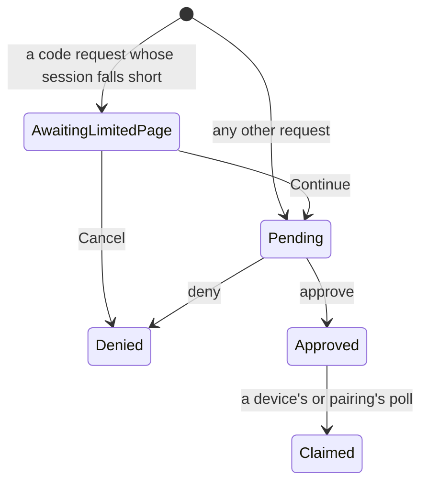

# Authorization Request

<!-- markdownlint-disable-file link-fragments -- the item-… anchors are added when the book is built. -->

{{#covers apps/host/wildflower-server/authorization-server-rust/src/domain/authorization_request/mod.rs}}
{{#covers apps/host/wildflower-server/authorization-server-rust/src/domain/authorization_request/approval.rs}}

Every request for access is parked as an **authorization request** until someone decides it: an app at `/oauth/authorize` asking for a code, a device asking for a token, a browser asking the Owner for a browser session. The Owner (or, for an app's request, a browser allowed to decide for them) answers it once. Each flow is its own type, with its own fields, states and transitions:

| Flow               | Type                                                                                           | Keyed by                   | Stored in                     | Ends                                             |
| ------------------ | ---------------------------------------------------------------------------------------------- | -------------------------- | ----------------------------- | ------------------------------------------------ |
| Authorization code | [`CodeRequest`](<Authorization Request/Code Request Explanation.md#item-CodeRequest>)          | an internal UUID           | `code_authorization_requests` | approved or denied; its code is what is redeemed |
| Device code        | [`DeviceRequest`](<Authorization Request/Polled Requests Explanation.md#item-DeviceRequest>)   | the device's `device_code` | `user_code_requests`          | claimed once by the device's poll                |
| Browser pairing    | [`PairingRequest`](<Authorization Request/Polled Requests Explanation.md#item-PairingRequest>) | the page's pairing code    | `user_code_requests`          | claimed once by the pairing page's poll          |

A code request has one state the others don't: when its browser session holds less than it asks for, it first waits on that browser's **limited page**, which asks the person at the browser whether to go on, and the Owner isn't asked about it until they do. The device and pairing flows share their shape instead: a `user_code` the Owner enters at the device page, and a poll that waits for the decision and then claims it. Their pages are [Code Request](<Authorization Request/Code Request Explanation.md>) and [Polled Requests](<Authorization Request/Polled Requests Explanation.md>).

**There's no expired state.** Expiry is a fact about time, so it is worked out from `expires_at` whenever someone asks, and never written. A code request stays approved for good: its single use is the [code](<Authorization Code Explanation.md>) it earned, not the request.

## Transitions and the guarded replace

A request is started by its flow's `new` and changed only by its flow's transitions. **A transition writes nothing.** It reads the request as loaded, takes `now`, and answers with the changed request, or a refusal such as [`NotPending`](#item-NotPending) when it no longer applies. The store then writes the changed request over the row with a **guarded replace**, one `UPDATE` that lands only while the row still has the status the request was read with:

{{#code apps/host/wildflower-server/authorization-server-rust/src/db/authorization_requests/mod.rs SqliteGrantTx::replace_code_request}}

**One affected row means "you won". None means someone moved the row first.** A decision that loses is answered as not found, since the request is no longer there for that caller; a claim that loses gets nothing; a poll stamp that loses is dropped. The same mechanism settles three races:

- **Two decisions on one request.** Both read it pending; the first write moves the status, and the second no longer matches.
- **Continue racing Cancel** on the limited page. Both read it awaiting the page; whichever lands moves the status, to pending or to denied, and the other no longer matches.
- **A poll stamp racing an approval.** A stamp leaves the status pending, so an approval read before the stamp still lands. A stamp read before the approval no longer matches, so it can't write the request back to pending.

The port declares one guarded replace per flow, {{#code-link apps/host/wildflower-server/authorization-server-rust/src/domain/grant_store/authorization_requests.rs AuthorizationRequestsTx::replace_code_request}} and its two siblings. Approving is the one transition that grants anything, so a source guard holds every `approve` and `claim` call to the writers and the proofs that may make them ({{#code-link apps/host/wildflower-server/authorization-server-rust/src/domain/capabilities/writers/mod.rs tests::APPROVAL_CONSTRUCTIONS}}).

## `domain::authorization_request`

### `AuthorizationRequest`

The tests build a code request from the [shared code-request arguments](<Test Fixtures Explanation.md#authorization-request>), on a fixed clock.

{{#item apps/host/wildflower-server/authorization-server-rust/src/domain/authorization_request/mod.rs AuthorizationRequest}}

#### Getters

{{#item apps/host/wildflower-server/authorization-server-rust/src/domain/authorization_request/mod.rs AuthorizationRequest::id}}

{{#item apps/host/wildflower-server/authorization-server-rust/src/domain/authorization_request/mod.rs AuthorizationRequest::client_id}}

{{#item apps/host/wildflower-server/authorization-server-rust/src/domain/authorization_request/mod.rs AuthorizationRequest::requested_scopes}}

{{#item apps/host/wildflower-server/authorization-server-rust/src/domain/authorization_request/mod.rs AuthorizationRequest::requested_at}}

{{#item apps/host/wildflower-server/authorization-server-rust/src/domain/authorization_request/mod.rs AuthorizationRequest::expires_at}}

{{#item apps/host/wildflower-server/authorization-server-rust/src/domain/authorization_request/mod.rs AuthorizationRequest::status}}

{{#item apps/host/wildflower-server/authorization-server-rust/src/domain/authorization_request/mod.rs AuthorizationRequest::flow_type}}

{{#item apps/host/wildflower-server/authorization-server-rust/src/domain/authorization_request/mod.rs AuthorizationRequest::user_code}}

#### `is_expired_at`

{{#item apps/host/wildflower-server/authorization-server-rust/src/domain/authorization_request/mod.rs AuthorizationRequest::is_expired_at}}

#### `is_pending_at`

{{#item apps/host/wildflower-server/authorization-server-rust/src/domain/authorization_request/mod.rs AuthorizationRequest::is_pending_at tests="tests::a_pending_request_is_pending_and_undecided_until_it_expires"}}

#### `is_undecided_at`

The host holds a consent open while the request it names is undecided, a code request still on its limited page included ([Owner Prompt](<Owner Prompt Explanation.md>)).

{{#item apps/host/wildflower-server/authorization-server-rust/src/domain/authorization_request/mod.rs AuthorizationRequest::is_undecided_at tests="tests::a_request_on_its_limited_page_is_undecided_but_not_pending"}}

### `RequestStatus`

{{#item apps/host/wildflower-server/authorization-server-rust/src/domain/authorization_request/mod.rs RequestStatus}}

### `FlowType`

{{#item apps/host/wildflower-server/authorization-server-rust/src/domain/authorization_request/mod.rs FlowType}}

### `NotPending`

{{#item apps/host/wildflower-server/authorization-server-rust/src/domain/authorization_request/mod.rs NotPending}}

### `DEVICE_CODE_POLL_INTERVAL`

{{#item apps/host/wildflower-server/authorization-server-rust/src/domain/authorization_request/mod.rs DEVICE_CODE_POLL_INTERVAL}}

## `domain::authorization_request::approval`

### `Approval`

What an approval grants is not the Owner's word alone: the approver's proof clamps it to what the approver may delegate and the request may receive ([Delegated Scopes](<../Authority/Delegated Scopes Explanation.md>)), and a code carries less again, only what its browser session also covers.

{{#item apps/host/wildflower-server/authorization-server-rust/src/domain/authorization_request/approval.rs Approval}}
