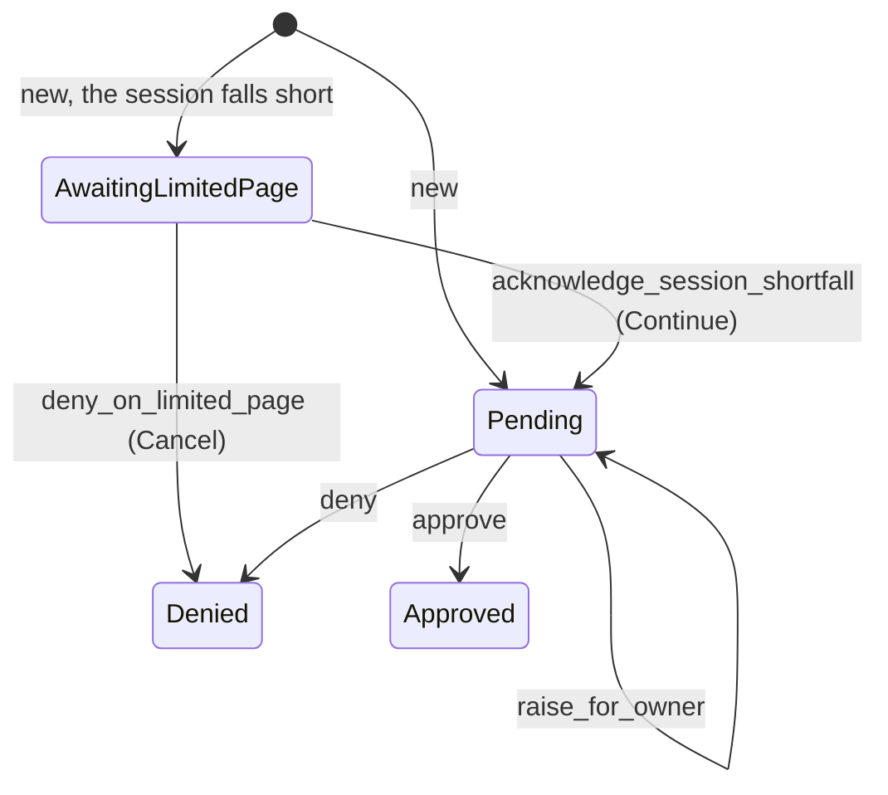

# Code Request

{{#covers apps/host/wildflower-server/authorization-server-rust/src/domain/authorization_request/code/mod.rs}}
{{#covers apps/host/wildflower-server/authorization-server-rust/src/domain/authorization_request/code/resolved.rs}}

A **code request** is an app's request for an authorization code (RFC 6749 §4.1), parked by `/oauth/authorize` until it is decided. It is always made in a [browser session](<../Browser Session Explanation.md>): `/oauth/authorize` sends a browser without one to sign in or pair first. **The code it earns is issued under that session, not the approver's**, and carries only what that session also covers.

## The limited page

Suppose the browser's session lacks a scope the app asks for: a laptop paired read-only, an app that wants write. The request starts **awaiting the limited page**, and the browser is sent there. The page says what's missing and offers **Continue** or **Cancel**. Until the browser goes on, the Owner isn't asked about the request and nothing decides it. Continue makes it pending with a fresh lifetime; Cancel denies it. Once a browser has pressed Continue for an app, its later requests for that app start pending: the page is shown once per browser per app. Both buttons are transitions read from the same status, so of two tabs pressing them at once only the first lands ([the guarded replace](<../Authorization Request Explanation.md#transitions-and-the-guarded-replace>)).

## Who decides

A pending request is decided by the Owner, or by the browser that made it when that browser's session may decide consents and holds what approving takes: then the browser shows the consent card itself. A browser that can read the request but not approve it can **raise** it for the Owner, after which the host notifies the Owner about it. When a [standing grant](<../Grant Explanation.md#when-a-grant-skips-the-owner>) covers the request, nobody decides: the request is parked and approved at once.

## Resolving against the registration

Every step that judges a code request, `/oauth/authorize`, the limited page's Continue, and the consent read and approval, learns what the app's [client](<../Client Explanation.md>) row says about it in one place: a **resolved code request**. It is worked out from the row as it stands on every read, never stored, so a consent prompt opened after the row moved shows the move. The most an approval may grant comes from {{#code-link apps/host/wildflower-server/authorization-server-rust/src/domain/authority/delegated_scopes.rs ApprovableScopes::for_code}}, which caps a fixed registration at itself.

## `domain::authorization_request::code`

The tests start a request at minute 0 that lives until minute 5, from the [code request fixtures](<../Test Fixtures Explanation.md#code-request>).

### `CodeRequest`

{{#item apps/host/wildflower-server/authorization-server-rust/src/domain/authorization_request/code/mod.rs CodeRequest}}

#### `new`

{{#item apps/host/wildflower-server/authorization-server-rust/src/domain/authorization_request/code/mod.rs CodeRequest::new tests="tests::a_new_request_starts_pending_or_on_its_limited_page"}}

#### `is_expired_at`, `is_pending_at` and `is_awaiting_limited_page_at`

{{#item apps/host/wildflower-server/authorization-server-rust/src/domain/authorization_request/code/mod.rs CodeRequest::is_expired_at}}

{{#item apps/host/wildflower-server/authorization-server-rust/src/domain/authorization_request/code/mod.rs CodeRequest::is_pending_at}}

{{#item apps/host/wildflower-server/authorization-server-rust/src/domain/authorization_request/code/mod.rs CodeRequest::is_awaiting_limited_page_at}}

#### `admits_patient`

**The person approving can't bind a patient other than the one the [launch](<../Launch Context Explanation.md>) bound.** The decision checks this before it approves, and the standing-grant fast path checks it against the grant's patient.

{{#item apps/host/wildflower-server/authorization-server-rust/src/domain/authorization_request/code/mod.rs CodeRequest::admits_patient tests="tests::admits_patient_holds_an_approval_to_the_launch_s_patient"}}

#### `approve`

The request records what was approved. The code issued for it carries less, only what the requesting browser's session also covers: that bound lives in the writer, {{#code-link apps/host/wildflower-server/authorization-server-rust/src/domain/capabilities/writers/request_approver.rs RequestApprover::approve_for_code}}, not on this entity.

{{#item apps/host/wildflower-server/authorization-server-rust/src/domain/authorization_request/code/mod.rs CodeRequest::approve tests="tests::approve_records_the_approval_only_while_pending"}}

#### `deny`

The same transition denies a request whose browser session ended before the approval could land, so the app hears `access_denied` instead of earning a code no live session bounds.

{{#item apps/host/wildflower-server/authorization-server-rust/src/domain/authorization_request/code/mod.rs CodeRequest::deny tests="tests::deny_decides_a_pending_request"}}

#### `raise_for_owner`

{{#item apps/host/wildflower-server/authorization-server-rust/src/domain/authorization_request/code/mod.rs CodeRequest::raise_for_owner tests="tests::raise_for_owner_stops_the_request_counting_as_decidable_where_it_was_made"}}

#### `acknowledge_session_shortfall`

The limited page's Continue.

{{#item apps/host/wildflower-server/authorization-server-rust/src/domain/authorization_request/code/mod.rs CodeRequest::acknowledge_session_shortfall tests="tests::acknowledge_session_shortfall_goes_on_past_the_limited_page_once"}}

#### `extend_limited_page_wait`

The browser asked the Owner to widen its session from the page: the request waits there as long as the [session widening](<Session Widening Explanation.md>) waits for the Owner.

{{#item apps/host/wildflower-server/authorization-server-rust/src/domain/authorization_request/code/mod.rs CodeRequest::extend_limited_page_wait tests="tests::extend_limited_page_wait_keeps_the_request_waiting_longer"}}

#### `deny_on_limited_page`

{{#item apps/host/wildflower-server/authorization-server-rust/src/domain/authorization_request/code/mod.rs CodeRequest::deny_on_limited_page tests="tests::deny_on_limited_page_applies_only_while_the_request_waits_there"}}

#### `require_pending` and `require_awaiting_limited_page`

{{#item apps/host/wildflower-server/authorization-server-rust/src/domain/authorization_request/code/mod.rs CodeRequest::require_pending}}

{{#item apps/host/wildflower-server/authorization-server-rust/src/domain/authorization_request/code/mod.rs CodeRequest::require_awaiting_limited_page}}

### `CodeRequestState`

{{#item apps/host/wildflower-server/authorization-server-rust/src/domain/authorization_request/code/mod.rs CodeRequestState}}

#### `status` and `approval`

{{#item apps/host/wildflower-server/authorization-server-rust/src/domain/authorization_request/code/mod.rs CodeRequestState::status}}

{{#item apps/host/wildflower-server/authorization-server-rust/src/domain/authorization_request/code/mod.rs CodeRequestState::approval}}

### `NewCodeRequestArgs`

{{#item apps/host/wildflower-server/authorization-server-rust/src/domain/authorization_request/code/mod.rs NewCodeRequestArgs}}

### `NotAwaitingLimitedPage`

{{#item apps/host/wildflower-server/authorization-server-rust/src/domain/authorization_request/code/mod.rs NotAwaitingLimitedPage}}

## `domain::authorization_request::code::resolved`

The tests resolve a request from `app` at the [fixture redirect](<../Test Fixtures Explanation.md#code-request>).

### `ResolvedCodeRequest`

{{#item apps/host/wildflower-server/authorization-server-rust/src/domain/authorization_request/code/resolved.rs ResolvedCodeRequest}}

#### `resolve`

{{#item apps/host/wildflower-server/authorization-server-rust/src/domain/authorization_request/code/resolved.rs ResolvedCodeRequest::resolve tests="tests::an_unknown_client_resolves_as_new_under_its_id tests::a_server_defined_registration_is_fixed tests::a_disabled_client_resolves_disabled"}}

#### Getters

{{#item apps/host/wildflower-server/authorization-server-rust/src/domain/authorization_request/code/resolved.rs ResolvedCodeRequest::client_name}}

{{#item apps/host/wildflower-server/authorization-server-rust/src/domain/authorization_request/code/resolved.rs ResolvedCodeRequest::is_client_disabled}}

{{#item apps/host/wildflower-server/authorization-server-rust/src/domain/authorization_request/code/resolved.rs ResolvedCodeRequest::is_registration_fixed}}

{{#item apps/host/wildflower-server/authorization-server-rust/src/domain/authorization_request/code/resolved.rs ResolvedCodeRequest::is_redirect_registered}}

`/oauth/authorize` refuses a fixed registration's request with `invalid_scope` when this is false, since an approval could never widen the registration.

{{#item apps/host/wildflower-server/authorization-server-rust/src/domain/authorization_request/code/resolved.rs ResolvedCodeRequest::are_scopes_registered}}

{{#item apps/host/wildflower-server/authorization-server-rust/src/domain/authorization_request/code/resolved.rs ResolvedCodeRequest::presented_client_change}}

{{#item apps/host/wildflower-server/authorization-server-rust/src/domain/authorization_request/code/resolved.rs ResolvedCodeRequest::approvable_scopes}}
