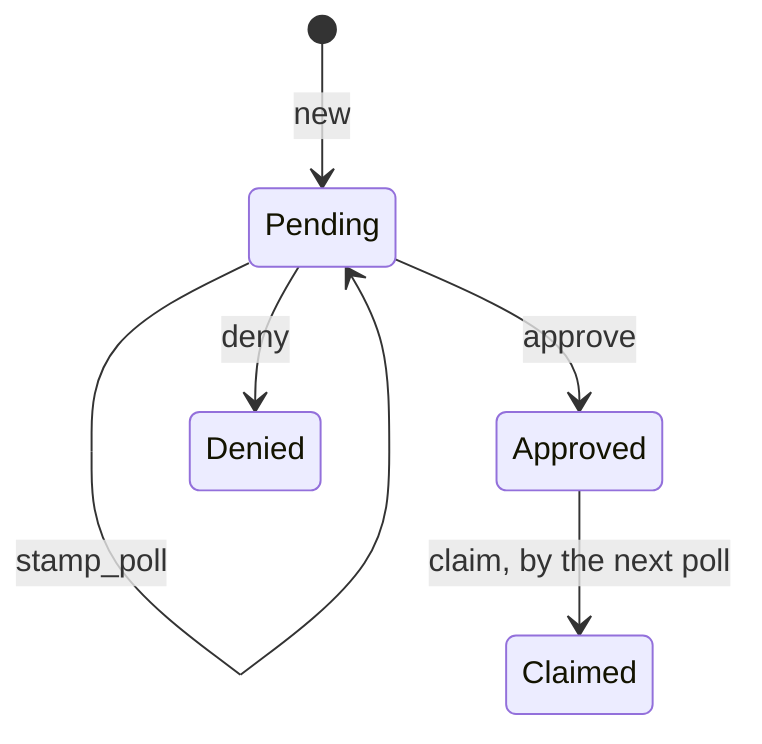

# Polled Requests

{{#covers apps/host/wildflower-server/authorization-server-rust/src/domain/authorization_request/polled.rs}}
{{#covers apps/host/wildflower-server/authorization-server-rust/src/domain/authorization_request/device.rs}}
{{#covers apps/host/wildflower-server/authorization-server-rust/src/domain/authorization_request/pairing.rs}}

Two flows ask from something that can't show the Owner a consent card itself, and so wait by polling:

- A **device request** (RFC 8628): a TV or a watch asks for a token, shows its user a short `user_code`, and polls `/oauth/token` with its `device_code` until the Owner decides.
- A **browser pairing**: a browser that isn't on the server's own device asks for a [browser session](<../Browser Session Explanation.md>) at `/oauth/pair`, shows a `user_code`, and polls with its pairing code. Pairing is no OAuth grant: its claim starts a paired session, and nothing is redeemed at `/oauth/token`.

Both are decided at the server's device page, where the Owner enters or confirms the `user_code`. The key the poll uses, the `device_code` or the pairing code, is a 256-bit secret only the poller holds; the `user_code` is short enough to type, and only finds the request for the Owner.

**An approval is redeemed once.** The poll after the Owner approves claims the request; a second claim finds it claimed and gets nothing. A claimed request keeps its approval, and an approved request past its expiry can't be claimed. **A poll is stamped**, so the next one can be told to slow down when it comes sooner than {{#code-link apps/host/wildflower-server/authorization-server-rust/src/domain/authorization_request/mod.rs DEVICE_CODE_POLL_INTERVAL}} after it. A stamp leaves the request pending, so an approval read before the stamp still lands after it ([the guarded replace](<../Authorization Request Explanation.md#transitions-and-the-guarded-replace>)).

## `domain::authorization_request::polled`

The tests run on a fixed clock, with the [polled-request fixtures](<../Test Fixtures Explanation.md#polled-requests>).

### `Polled`

{{#item apps/host/wildflower-server/authorization-server-rust/src/domain/authorization_request/polled.rs Polled tests="tests::a_poll_within_the_interval_of_the_last_one_is_too_soon tests::to_claimed_redeems_an_approved_request_once"}}

### `PolledState`

{{#item apps/host/wildflower-server/authorization-server-rust/src/domain/authorization_request/polled.rs PolledState}}

#### `status` and `approval`

{{#item apps/host/wildflower-server/authorization-server-rust/src/domain/authorization_request/polled.rs PolledState::status}}

{{#item apps/host/wildflower-server/authorization-server-rust/src/domain/authorization_request/polled.rs PolledState::approval}}

### `NotClaimable`

{{#item apps/host/wildflower-server/authorization-server-rust/src/domain/authorization_request/polled.rs NotClaimable}}

### `claimed_state`

{{#item apps/host/wildflower-server/authorization-server-rust/src/domain/authorization_request/polled.rs claimed_state}}

### `PolledRequest`

{{#item apps/host/wildflower-server/authorization-server-rust/src/domain/authorization_request/polled.rs PolledRequest}}

#### Getters

{{#item apps/host/wildflower-server/authorization-server-rust/src/domain/authorization_request/polled.rs PolledRequest::id}}

{{#item apps/host/wildflower-server/authorization-server-rust/src/domain/authorization_request/polled.rs PolledRequest::client_id}}

{{#item apps/host/wildflower-server/authorization-server-rust/src/domain/authorization_request/polled.rs PolledRequest::requested_scopes}}

{{#item apps/host/wildflower-server/authorization-server-rust/src/domain/authorization_request/polled.rs PolledRequest::user_code}}

{{#item apps/host/wildflower-server/authorization-server-rust/src/domain/authorization_request/polled.rs PolledRequest::is_pending_at}}

#### Into an `AuthorizationRequest`

For the reads that cross flows.

{{#item apps/host/wildflower-server/authorization-server-rust/src/domain/authorization_request/polled.rs AuthorizationRequest::from}}

## `domain::authorization_request::device`

### `DeviceRequest`

{{#item apps/host/wildflower-server/authorization-server-rust/src/domain/authorization_request/device.rs DeviceRequest}}

#### `new`

{{#item apps/host/wildflower-server/authorization-server-rust/src/domain/authorization_request/device.rs DeviceRequest::new tests="tests::a_new_request_is_pending_until_it_expires"}}

#### `to_approved`

The Owner may settle the name the device goes by, which keys its [device grant](<../Grant Explanation.md#item-DeviceGrant>).

{{#item apps/host/wildflower-server/authorization-server-rust/src/domain/authorization_request/device.rs DeviceRequest::to_approved tests="tests::to_approved_records_the_approval_and_the_device_s_name"}}

#### `to_denied`

{{#item apps/host/wildflower-server/authorization-server-rust/src/domain/authorization_request/device.rs DeviceRequest::to_denied tests="tests::to_denied_decides_a_pending_request"}}

#### `stamp_poll`

{{#item apps/host/wildflower-server/authorization-server-rust/src/domain/authorization_request/device.rs DeviceRequest::stamp_poll tests="tests::stamp_poll_records_the_poll"}}

#### `require_pending`

{{#item apps/host/wildflower-server/authorization-server-rust/src/domain/authorization_request/device.rs DeviceRequest::require_pending}}

#### `to_claimed`

The device's token poll claims the approved request through the [redemption proof](<../../Authority/Redemption Explanation.md>), and the pairing page's poll through the [browser pairing proof](<../../Authority/Browser Pairing Explanation.md>).

{{#item apps/host/wildflower-server/authorization-server-rust/src/domain/authorization_request/device.rs DeviceRequest::to_claimed}}

### `NewDeviceRequestArgs`

{{#item apps/host/wildflower-server/authorization-server-rust/src/domain/authorization_request/device.rs NewDeviceRequestArgs}}

### `device_grant_name`

{{#item apps/host/wildflower-server/authorization-server-rust/src/domain/authorization_request/device.rs device_grant_name tests="tests::the_grant_name_falls_back_to_the_client_s_name"}}

## `domain::authorization_request::pairing`

### `PairingRequest`

{{#item apps/host/wildflower-server/authorization-server-rust/src/domain/authorization_request/pairing.rs PairingRequest}}

#### `new`

{{#item apps/host/wildflower-server/authorization-server-rust/src/domain/authorization_request/pairing.rs PairingRequest::new}}

#### `to_approved`

The Owner may settle the name the browser goes by on the Owner's list of browsers. The session itself starts later, when the pairing page's poll claims the request.

{{#item apps/host/wildflower-server/authorization-server-rust/src/domain/authorization_request/pairing.rs PairingRequest::to_approved tests="tests::to_approved_records_the_approval_and_the_browser_s_name"}}

#### `to_denied`

{{#item apps/host/wildflower-server/authorization-server-rust/src/domain/authorization_request/pairing.rs PairingRequest::to_denied tests="tests::to_denied_decides_a_pending_pairing"}}

#### `stamp_poll`

{{#item apps/host/wildflower-server/authorization-server-rust/src/domain/authorization_request/pairing.rs PairingRequest::stamp_poll tests="tests::stamp_poll_records_the_poll_and_the_browser_s_name"}}

#### `require_pending`

{{#item apps/host/wildflower-server/authorization-server-rust/src/domain/authorization_request/pairing.rs PairingRequest::require_pending}}

#### `to_claimed`

{{#item apps/host/wildflower-server/authorization-server-rust/src/domain/authorization_request/pairing.rs PairingRequest::to_claimed tests="tests::to_claimed_redeems_an_approved_pairing_once"}}

### `PairingApproval`

{{#item apps/host/wildflower-server/authorization-server-rust/src/domain/authorization_request/pairing.rs PairingApproval}}

### `NewPairingRequestArgs`

{{#item apps/host/wildflower-server/authorization-server-rust/src/domain/authorization_request/pairing.rs NewPairingRequestArgs}}
