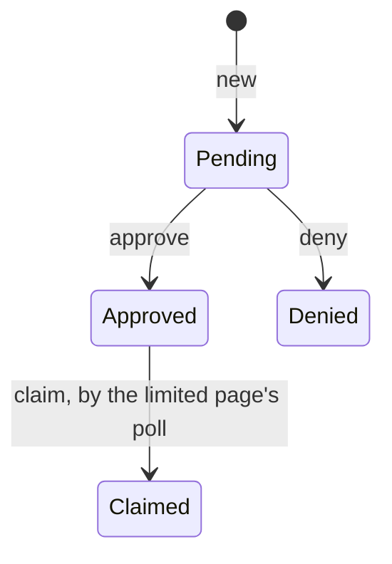

# Session Widening

<!-- markdownlint-disable-file link-fragments -- the item-… anchors are added when the book is built. -->

{{#covers apps/host/wildflower-server/authorization-server-rust/src/domain/authorization_request/session_widening.rs}}

A paired browser holds what the Owner let it hold when it paired. When an app asks for more, the browser lands on the [limited page](<Code Request Explanation.md#the-limited-page>), and from there it can **ask the Owner to widen its own session**, rather than pair again. Pairing again would end the session, and with it every token and refresh family minted under it.

A **session widening** is that ask. It names the session (`sid`), the app whose request the session fell short of, the session's name, and exactly what the session lacked of that request: the most the Owner may grant. The Owner decides it on its own card, and may only untick. An approval grows the session's scopes; the limited page's poll then claims it once, to take a token carrying them for the same session.

A widening shares the [polled requests'](<Polled Requests Explanation.md>) lifecycle, {{#code-link apps/host/wildflower-server/authorization-server-rust/src/domain/authorization_request/polled.rs PolledState}}, but no `user_code`: the browser asks on the server's own origin, with its session cookie, so the widening is keyed by its id, as a [code request](<Code Request Explanation.md>) is.

## `domain::authorization_request::session_widening`

### `SessionWideningApproval`

{{#item apps/host/wildflower-server/authorization-server-rust/src/domain/authorization_request/session_widening.rs SessionWideningApproval}}

### `SessionWideningRequest`

{{#item apps/host/wildflower-server/authorization-server-rust/src/domain/authorization_request/session_widening.rs SessionWideningRequest}}

### `NewSessionWideningRequestArgs`

{{#item apps/host/wildflower-server/authorization-server-rust/src/domain/authorization_request/session_widening.rs NewSessionWideningRequestArgs}}

#### `new`

{{#item apps/host/wildflower-server/authorization-server-rust/src/domain/authorization_request/session_widening.rs SessionWideningRequest::new}}

#### `is_expired_at` and `is_pending_at`

{{#item apps/host/wildflower-server/authorization-server-rust/src/domain/authorization_request/session_widening.rs SessionWideningRequest::is_expired_at}}

{{#item apps/host/wildflower-server/authorization-server-rust/src/domain/authorization_request/session_widening.rs SessionWideningRequest::is_pending_at}}

#### `approve` and `deny`

Only the [request approver](<../../Writers/Request Approver Explanation.md>) approves a widening, under the Owner's [delegated scopes](<../../Authority/Delegated Scopes Explanation.md>).

{{#item apps/host/wildflower-server/authorization-server-rust/src/domain/authorization_request/session_widening.rs SessionWideningRequest::approve}}

{{#item apps/host/wildflower-server/authorization-server-rust/src/domain/authorization_request/session_widening.rs SessionWideningRequest::deny tests="tests::a_pending_widening_is_decided_once_until_it_expires"}}

#### `claim`

The claim is the [claimed session widening](<../../Authority/Session Widening Explanation.md>)'s single use.

{{#item apps/host/wildflower-server/authorization-server-rust/src/domain/authorization_request/session_widening.rs SessionWideningRequest::claim tests="tests::claim_redeems_an_approved_widening_once"}}

#### `require_pending`

{{#item apps/host/wildflower-server/authorization-server-rust/src/domain/authorization_request/session_widening.rs SessionWideningRequest::require_pending}}

The tests run on a fixed clock:

{{#item apps/host/wildflower-server/authorization-server-rust/src/domain/authorization_request/session_widening.rs tests::at}}

{{#item apps/host/wildflower-server/authorization-server-rust/src/domain/authorization_request/session_widening.rs tests::started}}

{{#item apps/host/wildflower-server/authorization-server-rust/src/domain/authorization_request/session_widening.rs tests::approval}}
